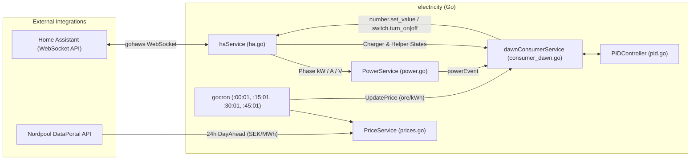

# Electricity Management Service

A Go service that manages residential electricity consumption and **Charge Amps Dawn** EV charging in real time via **Home Assistant** (WebSocket API) and **Nordpool** Day-Ahead spot prices.

It protects main household fuses (20A per phase) while maximizing EV charging speed (6A–16A) using a hybrid PID controller, hard safety overrides, solar surplus (PV-only) tracking, and quarter-hour spot price limits.

---

## Features

### 1. Real-Time 3-Phase Load Balancing & Fuse Protection
- **Setpoint:** Targets a maximum of **20A** on the most loaded phase (`MAX_PHASE_CURRENT = 20`).
- **PID Controller (`Kp=0.4, Ki=0.01, Kd=0.05`):** Smoothly adjusts charging current between **6A and 16A** (or up to an optional `DAWN_USER_LIMIT` soft cap) with a 30-second adjustment throttle and anti-windup clamping.
- **Hard Safety Override (> 22A):** Immediately steps down charging current if any phase exceeds `22.0A` (`setpoint + 2.0A`), using the lower of the requested setting or the car's actual OCPP current draw (`DAWN_CURRENT`) as the baseline, followed by a 60-second PID lockout.
- **Emergency Stop:** If overcurrent (`> 22.0A`) persists for more than **10 seconds** while the charger is already at its minimum (**6A**), charging is turned off via `DAWN_SWITCH` and a push notification is sent via Home Assistant.
- **Auto-Restart:** Automatically resumes charging at **6A** once there is at least **8A of headroom** on the highest-loaded phase (`maxPhaseCurrent <= 12.0A`) and the spot price is within the configured limit.

### 2. Nordpool Spot Price Smart Charging
- **24h Day-Ahead Caching:** Fetches today's and tomorrow's (after 13:00 CET/CEST) Day-Ahead prices from Nordpool (`github.com/tuomaz/nordpool`) and converts `SEK/MWh` to **`öre/kWh`**.
- **15-Minute Slot Alignment:** Evaluates price limits at the start of every 15-minute Nordpool slot (`:00:01`, `:15:01`, `:30:01`, `:45:01` `Europe/Stockholm`) as well as immediately when the price limit slider is adjusted in Home Assistant.
- **Configurable Price Ceiling (`PRICE_LIMIT_ENTITY`):**
  - Stops grid charging automatically when `currentPrice > currentPriceLimit`.
  - Setting the limit to `0` disables the price ceiling.
  - Ignored when **PV-Only Mode** is active so free solar charging continues regardless of spot price.

### 3. PV-Only (Solar Surplus) Mode
Toggled via a Home Assistant boolean helper (`PV_ONLY_SWITCH`):
- **Start Condition:** Starts charging at **6A** when total 3-phase net export (`sum(exports) - sum(imports)`) is at least **18A** (`6A × 3 phases`) for **5 consecutive minutes** (with a 15A hysteresis floor).
- **Dynamic Solar Tracking:** Uses the PID controller to maintain an average net export of **0.5A per phase** (`1.5A` total export buffer) so household loads and solar fluctuations don't pull from the grid. Per-phase 20A fuse protection remains active.
- **Stop Condition:** Stops charging if the charger is at **6A** and net grid import exceeds **3.0A** across all three phases for **5 consecutive minutes**.

---

## Architecture



| File | Description |
|------|-------------|
| [`main.go`](main.go) | Service initialization, environment parsing, quarter-hour `gocron` scheduler, and main event loop. |
| [`ha.go`](ha.go) | Home Assistant WebSocket wrapper (`github.com/tuomaz/gohaws`), state injection on connect, and service calls. |
| [`power.go`](power.go) | Converts phase import/export power (`kW`) and phase voltage (`V`) into phase currents (`A = kW × 1000 / V`, 230V fallback). |
| [`consumer_dawn.go`](consumer_dawn.go) | Core state machine for the Dawn charger: start/stop conditions, hard safety overrides, price ceiling, PV-only mode, and PID control. |
| [`pid.go`](pid.go) | Proportional-Integral-Derivative controller with integral anti-windup (`[-50, 50]`). |
| [`prices.go`](prices.go) | Fetches, caches, and rolls over 24h Nordpool price data in `Europe/Stockholm` time. |

---

## Configuration (Environment Variables)

### Required Variables

| Variable | Description | Example |
|----------|-------------|---------|
| `HAURI` | Home Assistant base URI | `https://ha.example.com:8123` |
| `HATOKEN` | Home Assistant Long-Lived Access Token | `eyJhbGciOi...` |
| `AREA` | Nordpool delivery area | `SE2` |
| `DAWN` | Entity ID for charger current limit (`number`) | `number.dawn_maximum_current` |
| `DAWN_SWITCH` | Entity ID for charger on/off control (`switch`) | `switch.dawn_charge_control` |
| `DAWN_CURRENT` | Entity ID for actual per-phase charging current (`sensor`) | `sensor.dawn_current_import` |
| `PV_ONLY_SWITCH` | Entity ID for PV-Only mode toggle (`input_boolean` / `switch`) | `input_boolean.ladda_endast_med_solel` |
| `NOTIFY_DEVICE` | Home Assistant `notify` target for emergency alerts | `mobile_app_my_phone` |

### Optional Variables & Sensor Overrides

| Variable | Default | Description |
|----------|---------|-------------|
| `DAWN_USER_LIMIT` | *(none)* | Optional soft charging current ceiling (`input_number`, 6–16A) |
| `PRICE_LIMIT_ENTITY` | *(none)* | Optional spot price limit in `öre/kWh` (`input_number`, `0` = no limit) |
| `PHASE_1_CURRENT` | `sensor.current_phase_1` | Fallback phase 1 RMS current sensor (A) |
| `PHASE_2_CURRENT` | `sensor.current_phase_2` | Fallback phase 2 RMS current sensor (A) |
| `PHASE_3_CURRENT` | `sensor.current_phase_3` | Fallback phase 3 RMS current sensor (A) |
| `PHASE_1_IMPORT` | `sensor.momentary_active_import_phase_1` | Phase 1 active import power sensor (kW) |
| `PHASE_2_IMPORT` | `sensor.momentary_active_import_phase_2` | Phase 2 active import power sensor (kW) |
| `PHASE_3_IMPORT` | `sensor.momentary_active_import_phase_3` | Phase 3 active import power sensor (kW) |
| `PHASE_1_EXPORT` | `sensor.momentary_active_export_phase_1` | Phase 1 active export power sensor (kW) |
| `PHASE_2_EXPORT` | `sensor.momentary_active_export_phase_2` | Phase 2 active export power sensor (kW) |
| `PHASE_3_EXPORT` | `sensor.momentary_active_export_phase_3` | Phase 3 active export power sensor (kW) |
| `PHASE_1_VOLTAGE` | `sensor.voltage_phase_1` | Phase 1 voltage sensor (V, defaults to 230V if `< 100V`) |
| `PHASE_2_VOLTAGE` | `sensor.voltage_phase_2` | Phase 2 voltage sensor (V, defaults to 230V if `< 100V`) |
| `PHASE_3_VOLTAGE` | `sensor.voltage_phase_3` | Phase 3 voltage sensor (V, defaults to 230V if `< 100V`) |

---

## Deployment & Development

### Docker Compose

See [`docker-compose.yml`](docker-compose.yml):

```bash
docker compose pull
docker compose up -d
docker logs -f electricity-electricity-1
```

### Local Build & Testing

```bash
# Run unit and integration tests
go test -v ./...

# Build binary
go build -o electricity .
```
